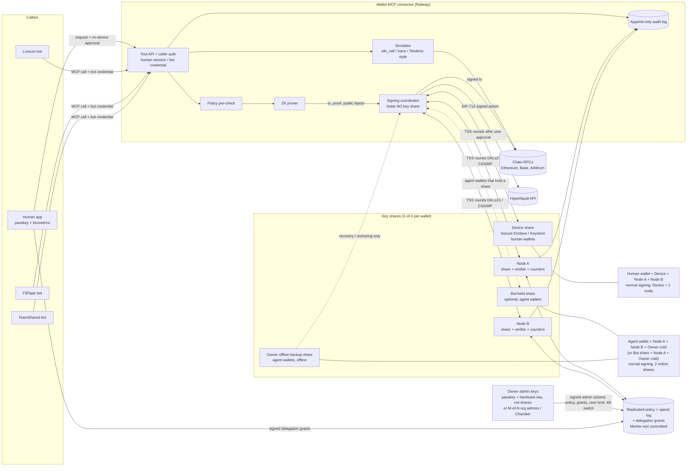

# keyshare

A threshold-signing wallet for humans and agents. The signing key is a plain EOA from a 2-of-3 distributed key generation, so the full private key never exists. Policy is enforced off-chain by the signer nodes and, in the target design, ZK proofs. There is no Safe or smart-account layer.

**Status:** design phase. Draft v0.1 (Oct 18, 2026). Phase 0 has not started. This repository is documentation only.

**License:** TBD

Full design: [docs/design.md](docs/design.md).

## What it is

One wallet API, with an MCP connector, that can read balances, send, swap, sign messages, call contracts, and trade on Hyperliquid. Two wallet types share the same key system.

**Human wallets.** The device share sits in the phone Secure Enclave or Android Keystore, behind a passkey or biometrics, with an encrypted backup. The user approves every signature on the device. Normal signing is the device plus one node.

**Agent wallets.** Used by an owner's bots. The first deployment is Chad's bots (Loreum, FillTape, TeamShared). Shares are held by nodes, or one share is bot-held, plus the owner's offline backup. Each bot has its own policy and limits. A node contributes its share only after a ZK policy proof shows the transaction is allowed. A human wallet can also delegate limited, expiring, revocable authority to an agent.

## Owner-admin model

Every user is the admin of their own wallets. Admin keys authorize policy, grants, over-limit approvals, and the kill switch. They are not key shares and cannot sign transactions by themselves. Organizations can use M-of-N admins, and Chamber can hold the admin role. Node operators, including Loreum, enforce policy and can halt signing. They cannot change policy, raise limits, or move funds alone.

## Trust model

Trust rests on fewer than *t* of *n* independent operators being compromised (2-of-3), plus the soundness of the policy circuit, rather than on a chip vendor's attestation. The coordinator holds no key share. There is no on-chain spending limit or time-lock: if the threshold is compromised or a policy bug lets a bad transaction through, the chain will accept it. Mitigations are small balances, separate wallets per bot, independent operators, resharing, and a kill switch.

## Architecture

## Roadmap

| Phase | Scope |
|---|---|
| **0 — Testnet MVP** | MCP connector, local single-key signer, simulation, plain-code policy, audit log, kill switch. **Not started.** |
| **1 — Interim production** (optional) | Same API, vendor policy-enforced keys (Turnkey, or Privy/CDP). Small mainnet balances. |
| **2a — Own TSS network** | DKLs23 2-of-3, plain-code policy at every node, human wallet app, owner admin model. |
| **2b — ZK policy proofs** | Nodes verify proofs against committed policy and spend roots. |
| **3 — Chamber offering** (optional) | Signer network and policy circuits for DAO and agent treasuries. |
| **4 — Multiple addresses** (later) | Labeled addresses from one threshold key via non-hardened derivation. |

Details, threat model, the MCP tool API, operations, and recovery are in [docs/design.md](docs/design.md).
