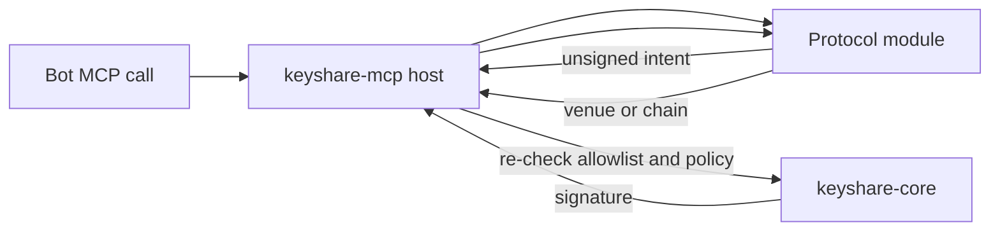

# Architecture

Keyshare is split so the part that holds the key can be read on its own. Protocol code lives in modules. A module prepares an unsigned intent. The core checks that intent and is the only component that signs.

## What stays in the core

`crates/keyshare-core` is key custody, policy, the transaction simulation gate's policy check, signing, the spend log, the audit log, and the kill switch. It has no HTTP client and no venue code.

These rules apply to every module, and a module cannot turn them off:

- chain allowlist
- daily and per-transaction caps
- owner approval for waivable refusals
- idempotency (`request_id`)
- `tx_status` for broadcasts the core sent
- kill switch

Generic tools stay on the host and call the core directly: `address`, `balances`, `send`, `call_contract`, `sign_message`, `sign_typed_data`, `simulate`, `limits`, `tx_status`. `limits` returns the core caps and spend, then each enabled module's own usage. Hyperliquid adds the `hyperliquid` object (equity floor, peak, headroom, latch).

## What a module does

A module implements [`ProtocolModule`](../crates/keyshare-module/src/lib.rs) and talks to the host through the [`Core`](../crates/keyshare-module/src/lib.rs) trait.

It declares:

- its MCP tool names
- the contract addresses, function selectors, and EIP-712 domains it may ask the core to sign
- how its own policy fields are validated
- any off-chain venue client it needs

The module returns an [`Intent`](../crates/keyshare-core/src/intent.rs): an unsigned transaction or an unsigned EIP-712 payload. The `Core` trait has no method that accepts a private key. `sign_venue` and `submit_module_tx` are requests. The host loads the key, checks the intent, and signs.

## The re-check

When a module is registered, the host snapshots its allowlist. Every later intent is checked against that snapshot, then against the bot's policy.

- A transaction must match a contract pattern the module declared (for Uniswap: `exactInputSingle` on the configured router, or `approve` of that router). It must also pass the bot's contract allowlist, caps, and the swap price check.
- A venue payload must match a declared EIP-712 shape. Hyperliquid L1 actions are the `Agent` type on the Exchange domain, chain id 1337, and `source` must be `b` (testnet). A payload with `source` `a` is mainnet and is refused here. Phase 0 does not sign Hyperliquid mainnet.

A bug in a module that emits some other address, selector, or domain does not get a signature. The core refuses it before the key is used.

## Enabling modules

Modules are on unless the config says otherwise. Existing files keep working: the same tool names, the same `[bots.<id>.hyperliquid]` fields, the same state files (`state_dir/hyperliquid/<bot>.agent.json`, `<bot>.day.json`, `<bot>.equity.json`).

`[bots.<id>.modules]` can set `hyperliquid = false` or `uniswap = false`. That bot's tool list then omits those tools, and a call to one is rejected as an unknown tool.

## Crates

| Crate | Depends on | Role |
|---|---|---|
| `keyshare-core` | alloy, serde | Custody, policy, intents, signing, audit. Auditable without the protocol crates. |
| `keyshare-module` | `keyshare-core` | `ProtocolModule`, `Core`, registry. |
| `keyshare-hyperliquid` | `keyshare-module` | Hyperliquid encoding, guardrails, HTTP client. |
| `keyshare-uniswap` | `keyshare-module` | Uniswap v3 quotes and unsigned swap transactions. |
| `keyshare-mcp` | core, module, both protocols | HTTP server, generic tools, agent-key file, owner CLI. |

`cargo audit -p keyshare-core` audits the custody crate without Hyperliquid or Uniswap dependencies. The workspace `cargo audit` still covers the whole lockfile.
