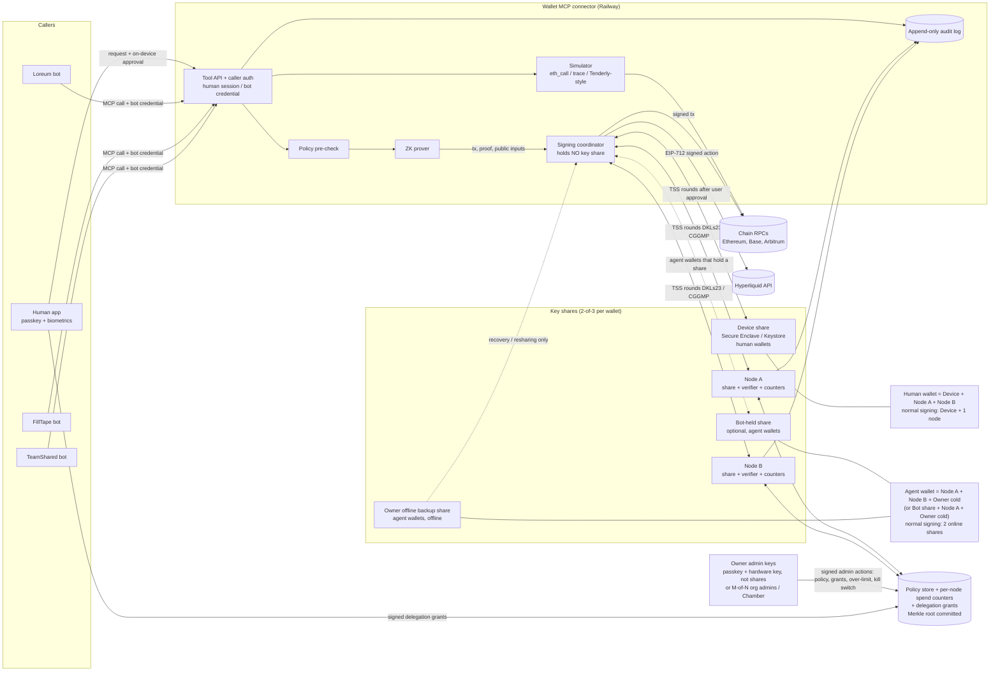
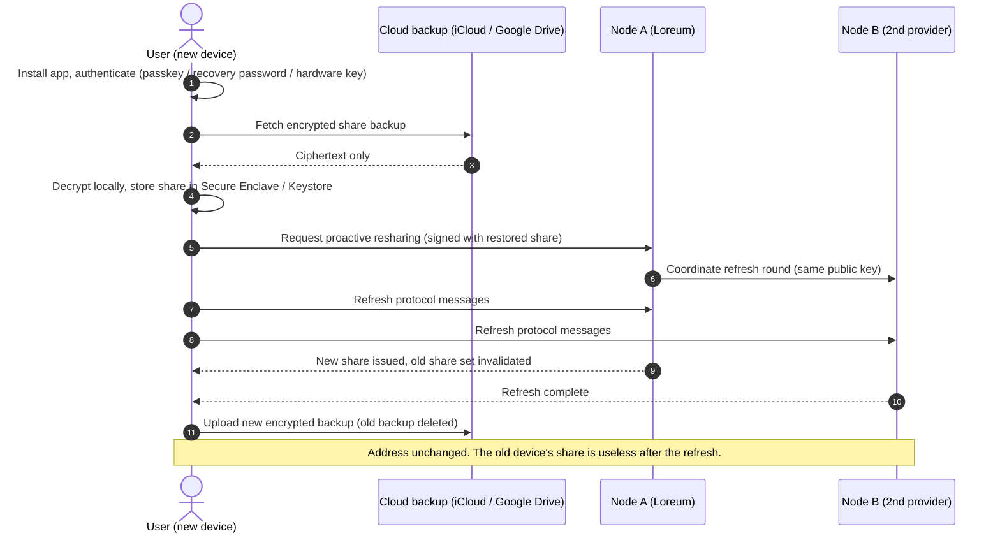
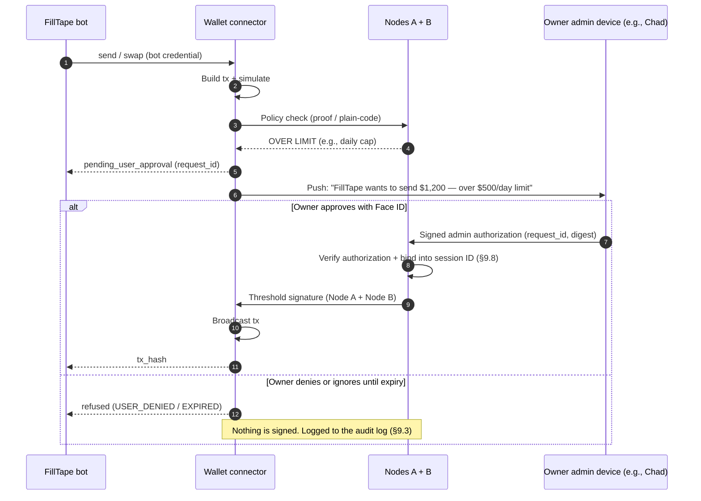
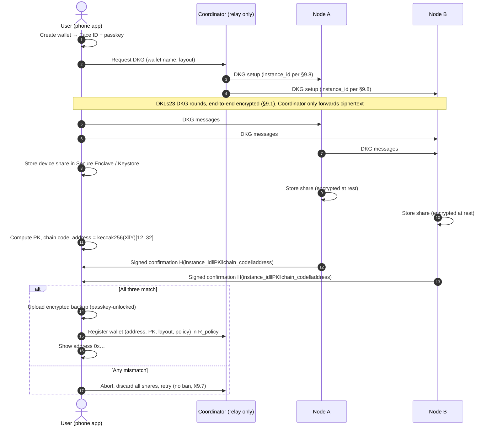

# keyshare design (threshold signing + ZK policy)

**Owner:** Chad Lynch · **Org:** Loreum DAO · **Status:** Draft v0.1 (Oct 18, 2026) · **Audience:** internal

---

## 1. Summary

We want one **general-purpose wallet system with an MCP connector** that serves **either a human or an agent**. It can read balances, send, swap, sign messages, call contracts, and trade on Hyperliquid. It supports two wallet types on the same key system:

- **Human wallets:** the user's **device share** sits in the phone's Secure Enclave / Android Keystore behind passkey/biometric auth, with an encrypted backup (§12). **The user approves every signature** on the device.
- **Agent wallets:** used by an owner's bots. The first deployment is Chad's bots (Loreum, FillTape, TeamShared). The shares are held by nodes, or one is bot-held. Each bot gets **its own automated policy and limits**, and the owner holds an **offline backup share**. A human wallet can also **delegate limited authority** to an agent (§6.1a).
- **Owner admin model:** every user is the admin of their own wallets, with M-of-N admins as an option for organizations, and Chamber can act as the admin. Node operators, including Loreum, enforce policy but can't change it (§15).

The signing key is a **plain EOA**. Its address is derived from a **threshold key** that is created by distributed key generation (DKG), so **the full private key never exists anywhere**, not at creation and not at signing time. Every wallet is **2-of-3**. A human wallet's three shares are the device share plus two independent **signer nodes**. An agent wallet's three shares are two node shares, or one bot-held share plus one node share, plus the owner's offline backup share. Before a node contributes its share to an agent signature, it checks a **ZK policy proof** showing the transaction is allowed (allowlisted recipient/contract, under the bot's daily cap, requested by an authorized bot). For a human wallet, the user's on-device approval is the main control and the nodes enforce baseline rules. If fewer than *t* parties agree, nothing gets signed.

This is the "virtual TEE" Chad asked about. It isn't built on plain Shamir sharing, because Shamir has to put the key back together to sign. It uses **threshold signatures (TSS) plus ZK proofs**, so trust rests on "fewer than *t* of *n* independent operators are compromised" rather than on a chip vendor's attestation.

**Recommended path:** Phase 0 testnet with a simple local signer → Phase 1 production on a vendor policy-enforced key (Turnkey, or Privy/CDP) behind the same MCP API → Phase 2 our own 2-of-3 TSS network with ZK policy proofs, no trusted vendor, and potentially packaged as part of **Chamber**.

---

## 2. Goals and non-goals

### Goals
- **One wallet API for humans and agents.** Every caller, human or bot, gets an identity, its own limits, and its own audit trail.
- **Two wallet types on one key system.** Human wallets use user-approved signing with the device share. Agent wallets use automated per-bot policy. A human can delegate limited, expiring, revocable authority to an agent.
- **No single point of key compromise.** In the end state, no machine, person, or vendor ever holds the full key.
- **Policy enforced at the signer, not in the caller.** A compromised bot, app, or MCP server can't produce a signature outside policy or without the user's approval.
- **Simulate before sign.** Every state-changing request is dry-run first, and the result (asset deltas, recipient, approvals) is returned and logged.
- **Fast enough for agents.** Normal transfers and calls finish in seconds (target, see §6.5).
- **Operable by a small team.** Kill switch, key-share rotation (resharing), revocation, and recovery are all documented and rehearsed.
- **Multi-chain.** EVM (Ethereum, Base, Arbitrum) first. Hyperliquid through an agent/API wallet. Ed25519/Schnorr chains later via FROST.

### Non-goals
- **No Safe / smart-account / multisig wrapper (deliberate decision).** Signing happens with a plain EOA, and every limit is enforced off-chain by the threshold signer nodes plus ZK policy proofs.
  - *What we gain:* works on every EVM chain and every dapp that expects an EOA (including Hyperliquid's EIP-712 signing). No contract deployment, no per-chain setup, no extra gas from a wrapper, no smart-contract audit surface, and simpler ops.
  - *What we give up:* there is **no on-chain backstop**. If *t* nodes are compromised or a policy bug lets a bad tx through, the chain will accept it. There's no on-chain spending limit, no time-lock, and no on-chain owner rotation. Rotating the EOA *address* means moving funds. Mitigations: keep balances small per wallet, use separate wallets per bot, run independent node operators, use resharing, and have the kill switch (§9).
- Not a custody product for third-party funds (yet). That's a Chamber decision for later (§10).
- No key reconstruction for routine operations. Key export exists only as a documented break-glass path (§9.6).

---

## 3. Threat model

| # | Threat | Example | Primary defense |
|---|--------|---------|-----------------|
| T1 | Compromised bot / prompt injection | A bot is tricked into "send all ETH to 0xattacker" | Per-bot policy enforced by signer nodes, allowlists, daily caps, and simulation. The bot can't change policy. |
| T2 | Compromised MCP server / coordinator | Attacker controls the wallet connector on Railway | The coordinator holds **no key share**. Nodes verify the ZK proof and recompute the tx digest themselves, so a coordinator can't get an out-of-policy tx signed. It *can* still attempt key destruction or framing as a relay, see T12. |
| T3 | Single signer node compromise | VPS breach on one node | Below threshold (1 of 3), the attacker learns nothing usable. Proactive resharing makes stolen shares stale, **but only if the suspect node is removed before any refresh** (§9.5, TOB-SILA-4). Cheating during signing triggers the ban rules (§9.7). A compromised node also cannot raise or erase another node's spend counter (§6.4). |
| T4 | *t* nodes compromised | Same cloud account or same admin holds 2 of 3 nodes | Independent hosting, operators, and credentials (§9.1). This is the residual risk we accept without an on-chain backstop. |
| T5 | Policy / circuit bug | Circuit fails to constrain `to` or `value` | Audits, differential testing of the circuit against a plain-code policy checker, conservative caps, small balances. |
| T6 | Blind-signing / digest mismatch | Coordinator sends a digest that doesn't match the tx it showed | Nodes **rebuild the signing hash from the raw tx/typed data** and bind it as a public input to the proof. They never sign a bare hash. |
| T7 | Replay / double-spend of allowance | The same approval reused to exceed the daily cap | Nonce-bound requests, each signer's own append-only spend counter (§6.4), and chain nonces. The cap holds when an honest node is in the signing quorum. A crash-fault log such as Raft is not the defense. |
| T8 | Malicious typed data (Permit / Permit2 / setApprovalForAll) | "Just sign this message" that is actually an unlimited token approval | Typed-data decoding plus a deny list of dangerous primitives unless explicitly allowlisted. Approvals are capped by amount and expiry. |
| T9 | Vendor risk (Phase 1) | Turnkey, Privy, or CDP outage, compromise, or policy change | An interim phase only, behind our own API so we can swap backends. Small balances. |
| T10 | Loss of availability | 2 of 3 nodes offline means no signing | Monitoring, a spare node for resharing, and documented recovery (§9.6). |
| T11 | Owner admin key compromise / insider | An owner's phone passkey or hardware admin key is stolen and used to approve over-limit sends, loosen policy, or swap admin keys | Two admin keys per owner (§15.3). Loosening, admin-key changes, and unfreeze are timelocked and cancellable by the other key. An optional hard ceiling needs both keys. Node-side caps still bind. Every admin action notifies all admin devices. |
| T12 | Key destruction / framing via the relay or network | The coordinator (it relays every TSS message) or any on-path attacker tampers with, replays, or splits messages so honest parties abort or **denylist each other** until the threshold can't be reached. Trail of Bits showed this class in Silence Labs' DKLs23 library: nonce reuse (TOB-SILA-6), split session IDs (TOB-SILA-8), replay (TOB-SILA-9), and forged-message aborts (TOB-SILA-14) ([report](https://github.com/trailofbits/publications/blob/master/reviews/2024-02-silencelaboratories-silentshard-securityreview.pdf)) | End-to-end transport between parties with **per-direction keys**, silently dropping unauthenticated messages, broadcast agreement checks (§9.1), unique bound session IDs (§9.8), and ban rules that never ban on timeouts or forged messages (§9.7). The owner's cold share or the device share is the fallback if two parties are wrongly split. |
| T13 | Admin collusion (M-of-N org wallets) | M organization admins collude to drain a treasury or raise limits | By design M admins can act. Choose M ≥ a majority, put timelocks and notifications to all admins (and optional observers) on loosening and admin-set changes, add hard per-period ceilings that need a higher quorum, or use Chamber governance as the admin for large treasuries (§15.4–15.5). |

**Out of scope:** an attacker who controls *t* or more independent nodes *and* the owner's admin keys (or M organization admins) at the same time. That's game over by design.

---

## 4. Architecture



**Request flow (state-changing call):**
1. A caller invokes a tool, e.g. `send`. A bot uses its bot credential, and a human uses an app session bound to a passkey. The API authenticates the caller and resolves its `caller_id` (`bot_id` or `user_id`) and wallet.
2. **Simulate.** The connector builds the exact tx (nonce, gas, chainId), simulates it, and extracts asset deltas, approvals, and touched contracts.
3. **Policy pre-check** in plain code. It fails fast with a readable reason (for example "recipient not allowlisted for filltape").
4. **Prove.** The prover generates a ZK proof that this exact tx satisfies the bot's policy against the current committed policy/spend root (§6).
5. **Sign.** The coordinator sends `(raw tx, proof, public inputs)` to the nodes. Each node independently (a) rebuilds the signing digest from the raw tx, (b) checks that the digest matches the proof's public input, (c) verifies the proof, (d) checks its own view of the bot's spend counter, kill-switch flag, and request nonce, then (e) runs its part of the TSS signing round. With *t* honest approvals, a standard ECDSA signature comes out for the EOA.
6. **Broadcast and log.** The signed tx is broadcast. Every step is appended to the audit log with `bot_id`, request id, simulation summary, proof hash, node approvals and refusals, and tx hash.

**Human wallets differ at step 5.** The connector sends the simulation summary (asset deltas, recipient, approvals) to the user's device. The user approves with biometrics or a passkey, and only then does the device share join the TSS round with one node. The node still checks its baseline rules (§6.1a). If the user doesn't approve, nothing is signed. **Agent wallets** sign automatically with two online shares (Node A + Node B, or bot share + Node A) once the policy proof verifies.

Read-only tools (`address`, `balances`, `tx_status`, `simulate`) never reach the signers.

---

## 5. Key management options compared

| Option | How it works | Full key ever exists? | Trust assumption | Policy enforcement | Latency / ops | Fit |
|---|---|---|---|---|---|---|
| **Raw key** (env var / KMS-stored secret) | One private key on a server | Yes, always | The server and anyone who can read the secret | Only in our app code, so a compromised app bypasses it | Fastest, trivial ops | Testnet only (Phase 0) |
| **TEE / vendor (Turnkey, Privy, Coinbase CDP)** | Key lives and signs inside AWS Nitro enclaves. The vendor policy engine runs in the enclave | Yes, inside the enclave | Chip vendor attestation + the vendor's code and ops | Vendor policy engine (deny-by-default) | Fast. Turnkey advertises sub-100ms signing. Vendor-managed | Good interim (Phase 1) |
| **MPC-TSS** (DKLs23, CGGMP21/24 for ECDSA; FROST for Schnorr/EdDSA) | DKG gives each node a share. Nodes jointly sign without reconstructing | **Never** | Fewer than *t* of *n* nodes compromised | Each node runs policy code before signing | Multi-round network protocol, we run the nodes | Strong core |
| **Shamir secret sharing (plain)** | The key is split into shares that are recombined to sign | Yes, at every signing | Whoever does the recombining | Wherever it's recombined | Simple, but recombination is a single point of failure | **Rejected** for signing. Fine for cold backup |
| **TSS + ZK policy proofs (target)** | Same as MPC-TSS, plus every node verifies a succinct proof that the tx satisfies a committed policy | **Never** | Fewer than *t* of *n* nodes + soundness of the proof system and circuit | Cryptographic: nodes only check a proof against a committed root, and the rules are auditable | TSS rounds + proving time (§6.5) | **Phase 2 target** |

Verified notes on the products and libraries:
- **Turnkey** runs key generation, signing, and its policy engine inside AWS Nitro Enclaves. Policies are JSON, deny-by-default, and can match on recipient, contract, function selector, chain id, and value. Note that a *root quorum bypasses policies*. Turnkey also offers "policy outcome proofs" of enclave decisions. ([docs](https://docs.turnkey.com/features/policies/overview), [enclaves](https://docs.turnkey.com/security/secure-enclaves))
- **Privy server wallets** use a 2-of-2 Shamir split (an enclave share plus an API share) that is **reconstructed inside an AWS Nitro TEE** to sign, with policies on amounts, recipients, contracts, networks, and calldata. ([docs](https://docs.privy.io/security/wallet-infrastructure/architecture))
- **Coinbase CDP server wallets** also use AWS Nitro TEEs and a fail-closed policy engine. ([docs](https://docs.cdp.coinbase.com/wallets/security-and-policies/policy-engine/overview))
- **Lit Protocol** is a useful data point: its V3 "Chipotle" (GA April 2026) moved from network-coordinated threshold signing to TEE execution, with permissions stored on Base. ([Lit blog](https://spark.litprotocol.com/lit-v3-is-live-confidential-compute-and-key-management-in-one-api/))

---

## 6. Policy engine and ZK circuit design

### 6.1 Policy model (agent wallets, per bot)
```yaml
bot: filltape
wallet: 0xFill...            # one EOA per bot (recommended), derived from its own DKG
chains: [8453, 42161]        # Base, Arbitrum
daily_cap_usd: 500           # rolling 24h, measured at signing time
per_tx_cap_usd: 200
recipients_allow: [0xHL_bridge..., 0xOwnerColdWallet...]
contracts_allow:
  - addr: 0xUniversalRouter...
    selectors: [0x3593564c]  # execute
  - addr: 0xUSDC...
    selectors: [0xa9059cbb]  # transfer only; approve requires explicit entry
typed_data_allow: [HyperliquidSignTransaction, Permit2(bounded)]
deny: [setApprovalForAll, unlimited approve, delegatecall targets]
require_admin_cosign_above_usd: 1000   # owner admin key approves (M-of-N for org wallets), §15
```
Policies live in a **replicated policy store**. Every version is hashed into a Merkle tree, and its root `R_policy` is what proofs reference. Only the wallet owner's admin authorization can change it (§15; M-of-N for organization wallets). **Loosening** a limit takes effect after a delay (for example 24h, to be decided). **Tightening** and the kill switch take effect immediately.

### 6.1a Human approval vs automated agent policy, and delegation
- **Human wallets (user-approved signing).** No signature happens without the user's on-device approval: biometrics or a passkey unlocks the device share for that one request, and the approval screen shows the simulation result. The nodes enforce only a **baseline**: the deny list for dangerous typed data (§3 T8), the kill switch, recovery timelocks (§12.4), and optional user-set caps. The user's approval is the main control, and the ZK proof is not required for human-approved requests. The same Face ID approval **doubles as the owner's admin action** (§15.2).
- **Agent wallets (automated policy).** Signing is automatic within the per-bot policy in §6.1, enforced by the nodes through the ZK policy proof (§6.2). There's no human in the loop, except `require_admin_cosign_above_usd` and other over-limit requests, which need the **owner's admin key** (§15.2).
- **Delegation from a human wallet to an agent.** A human can give an agent **limited, expiring, revocable authority** with a **delegation grant**: an EIP-712 message signed by the human wallet that names `agent_id`, scope (chains, allowlist, selectors), `per_tx_cap`, `daily_cap`, and `expiry`. It's stored as a leaf in `R_policy`. Two forms:
  1. **Fund an agent wallet (default).** The human sends a budget to a separate agent wallet, and the grant sets that wallet's policy. The human wallet's own shares never sign for the agent, so the blast radius is limited to the budget.
  2. **Session grant on the human wallet (optional, small caps).** The two nodes may co-sign for the agent on the human wallet **within the grant only**, without the device. This is convenient, but it means the nodes can sign for that wallet within those limits, so keep caps small and expiry short.
  - Revocation happens through a signed `revoke_delegation` from the human device (immediate), the expiry, or the kill switch.

### 6.2 What the proof shows
For a request `req`, the prover shows:

1. `digest = keccak(RLP(tx))` (or the EIP-712 digest for typed data), and `tx` parses to `(chainId, to, value, data, nonce)`.
2. `bot_id` is authorized for this wallet: the leaf `(bot_id, wallet, policy_hash)` is in `R_policy`, and the request carries a valid signature from the bot's credential key.
3. `to` (and for ERC-20 transfers, the decoded recipient) is in the bot's allowlist. If `to` is a contract, the `(to, selector)` pair is allowlisted.
4. `usd_value(tx) <= per_tx_cap`, and `spent_24h(bot) + usd_value(tx) <= daily_cap`, where `spent_24h` is proven against the spend-log root `R_spend`.
5. The kill-switch flag in `R_policy` is off for this bot and globally.
6. The request nonce is fresh (not in `R_spend`'s used set).
7. For delegated requests: a valid, unexpired, unrevoked delegation grant signed by the human wallet is in `R_policy`, and the tx fits inside the grant's scope and caps.

### 6.3 Public vs private inputs
| Public (every node sees and checks) | Private (witness, only the prover needs it) |
|---|---|
| `digest` (each node recomputes it from the raw tx) | Full allowlist and Merkle paths |
| `R_policy`, `R_spend` (must equal the node's own view) | Bot's `spent_24h` breakdown |
| `bot_id`, `wallet`, `chainId` | Price inputs used for USD conversion (signed oracle quotes) |
| request nonce, timestamp window | The bot's request signature (verified in-circuit) |
| `new_R_spend` (the updated root after this spend) | Policy details the bot doesn't need to see |

> **Honest note on why ZK at all:** with only 2–3 nodes that each hold full state, every node could simply run the policy in plain code. ZK earns its place because (a) nodes don't each need the full private policy or spend history, only a root and a proof; (b) the same proof is **verifiable by third parties or on-chain**, which matters if this becomes part of Chamber; and (c) it standardizes "what the policy is" as a circuit that can be audited. **Phase 2a can ship plain-code policy checks at every node first, then swap in proofs (2b) without changing the API.**

### 6.4 Shared spending state (daily caps)
Daily caps are state. A bot must not be able to spread spends across nodes, and a compromised node (T3) must not be able to erase or rewrite what an honest node has already counted. **Raft is not used.** It is crash-fault tolerant only: a malicious replica can equivocate, forge entries, or stall commit, and the threat model already assumes one signer node can be compromised.

**Recommended: per-node signed counters.** Each signer keeps its own append-only spend log and signs each new head. Before it contributes a share it checks the request against **its own** `spent_24h` and used-nonce set, and it refuses if this spend would pass its cap or reuse a nonce it has recorded. It appends the spend when it approves the request to sign, not only after broadcast. A signature needs *t* shares, so the cap holds as long as **one honest node is in the signing quorum**: that node will not sign past its own counter. In the normal 2-of-3 agent path (Node A + Node B), one honest node of the two is enough. A compromised node can under-count on its own log and still vote yes. It cannot make an honest node forget a spend that node has signed.

Tradeoffs of independent counters:
- **The cap is enforced locally, and views can drift.** If a round aborts after one node has counted and another has not, the node that counted is conservative and may refuse a later spend the other would allow. A node that was not in an earlier session, and has not learned of it, still has a low counter. Closing that gap is what the optional BFT log is for. Until then, peers publish signed log heads after an abort or a completed signature. A node may adopt a spend it did not see when the entry is signed by a party that was in that session. It never rolls its counter backward.
- **Leak at the edges.** A compromised node can still co-sign up to the cap with an honest node whose counter is missing earlier spends (the honest node was offline, or the spends were sessions it did not join and has not imported). The honest node's refusal only covers spends it knows. Monitoring `R_spend` divergence (§9.2) is the tripwire for that drift.
- **ZK proofs.** Each node checks the proof's `R_spend` against **its own** root, not against a cluster-committed root. A proof built on a compromised node's smaller root fails at the honest node. `new_R_spend` is that node's next root.

**Optional: a BFT log, for one shared root.** If the operators want a single `R_spend` instead of drifted counters, the signer nodes can keep a Byzantine log. The root advances only when that log commits the entry, and a node refuses to sign unless the proof's `R_spend` is its latest committed root. This serializes spends and removes the drift leak. The cost is a BFT implementation, liveness tied to the BFT quorum, and extra latency. It is not required for the cap invariant above. Raft is not a substitute: a crash-fault log trusts replicas not to lie, and a compromised node is a Byzantine replica.

**On-chain anchoring** of a spend root (for example on Base) remains a possible Chamber feature for a public audit trail. It is not needed for v1, and it does not replace the per-node refusal check.

USD pricing uses a signed price quote (for example from a Chainlink or Pyth reading fetched by the coordinator, signature-checked in-circuit or by the nodes), with a staleness bound. Stablecoins are priced at 1.0 with a depeg guard.

### 6.5 Candidate proving systems
| System | Style | Pros for us | Cons / notes |
|---|---|---|---|
| **Noir** (Aztec, Barretenberg / UltraHonk backend) | DSL circuits | Rust-like, good ergonomics, fast for small circuits. Public benchmarks show small Merkle-membership circuits proving in **well under ~2 s** on desktop/browser hardware ([benchmarks](https://hashcloak.github.io/semaphore-noir-final-report/benchmarks.html)) | keccak and RLP in-circuit are expensive. We'd likely use Poseidon for internal roots and prove keccak only on the tx digest |
| **RISC Zero** | zkVM (RISC-V, write Rust) | Reuse our exact Rust policy code and alloy tx parsing. Easy to audit "same code as the plain checker" | Proving is much heavier than a custom circuit. Public zkVM benchmarks are in the tens of seconds to minutes for large programs ([zkbenchmarks](https://zkbenchmarks.com/)), so a GPU or a proving network is needed for low latency |
| **SP1** (Succinct) | zkVM (RISC-V, Rust) | Same benefits as RISC Zero, with strong GPU performance (SP1 Hypercube real-time L1 proving on 16 GPUs, [blog](https://blog.succinct.xyz/real-time-proving-16-gpus/)). Can wrap to Groth16 for cheap on-chain verification | GPU or proving-network cost. The Groth16 wrap adds time |
| **Circom + Groth16** | R1CS circuits | Smallest proofs, cheapest on-chain verification, mature | Per-circuit trusted setup, low-level language, more audit risk when changing the policy |

**Recommendation (estimate, to validate in a spike):** use **Noir/UltraHonk** for the hot path (allowlist membership + cap arithmetic + bot signature, with internal roots in Poseidon), and the **tx digest bound as a public input** that nodes recompute natively instead of proving keccak/RLP in-circuit. Keep **SP1** as the option if we want "prove the same Rust policy code" or need on-chain verification. We have no measured numbers yet. The *target* budget is ≤2 s proving + ≤1 s TSS for a normal send, to be confirmed in Phase 2a. Verification on nodes is cheap compared with proving (milliseconds-scale for SNARKs, estimate).

**Cost notes (estimates, not quotes):** the Noir path runs on a normal CPU on the connector host, so the marginal cost is roughly zero. A zkVM on a proving network or GPUs has a per-proof cost we haven't priced. If we ever verify on-chain, Groth16 is the cheapest verifier.

### 6.6 Threshold signing choice
- **EVM (secp256k1 ECDSA):** **DKLs23** via Silence Laboratories' `dkls23` (Rust; supports DKG, key refresh, **quorum change**, and import/export) ([repo](https://github.com/silence-laboratories/dkls23)). **Audit facts** ([Trail of Bits report](https://github.com/trailofbits/publications/blob/master/reviews/2024-02-silencelaboratories-silentshard-securityreview.pdf), [ToB blog, Jun 10, 2025](https://blog.trailofbits.com/2025/06/10/what-we-learned-reviewing-one-of-the-first-dkls23-libraries-from-silence-laboratories/)): ToB reviewed `dkls23@1510c2fafe3c` + `sl-crypto@a6b014722a29` **Nov 20 – Dec 8, 2023** (the blog says "October 2023"), reviewed fixes **Jan 22–30, 2024**, and dated the report **Feb 2024**. They found 15 issues (2 High, 5 Medium, 2 Low, 6 Informational), with no direct key-recovery bug but several key-destruction paths. 14 were resolved and TOB-SILA-13 was partially resolved. The audit scope covered DKG **with key refresh**, signing, OT, messaging, and (as a supplement) RVOLE. It did **not** list quorum change, import/export, or migration. Or **CGGMP** via LFDT-Lockness `cggmp21` (MIT/Apache-2.0, audited by Kudelski; **must be ≥0.6.3** because of a critical Nov 2025 advisory where one malicious signer could reconstruct the key, and the maintainers recommend migrating to `cggmp24`; the crate does **not** currently support key refresh for t-of-n keys) ([advisory](https://github.com/LFDT-Lockness/cggmp21/security/advisories/GHSA-m95p-425x-x889)). Coinbase's `cb-mpc` (C++, MIT) is a third option.
  - **Pick: DKLs23** for 2-of-3, because it has built-in refresh and quorum change, which we need for resharing. Note that the low-level library leaves message auth/encryption, replay protection, and presignature single-use storage to us, and **we must hash the message ourselves before calling sign**, per the library's warning.
  - **Pinning:** use the high-level `dkls23` crate (not `-ll`), pinned to an exact git rev or crate version (current crate `sl-dkls23` 1.0.0-beta) with a committed `Cargo.lock`. Keep a recorded diff against the audited and fix-review commits, run `cargo-audit` in CI, and track advisories. **All parties run the identical version**: nodes, the device app (prefer native over WASM builds), and the owner's cold-share tool. The library's versioned domain labels (TOB-SILA-11 fix) make mismatches abort early.
  - **Confirm quorum-change audit coverage** with Silence Labs before relying on it for node replacement or recovery (§9.5, §9.6, §12). If it isn't covered, have our auditor review it, or replace parties through a new DKG plus moving funds until it is.
  - **License review:** the repo and crate license is non-standard ("Other"). It needs legal review before production and before any Chamber offering.
  - **No presignatures in v1.** Signing runs fully online per request. The library doesn't store presignatures or partial signatures, and the user must guarantee no reuse. If presignatures are added later for latency, they must be encrypted at rest, marked consumed in each signing party's own append-only log (§6.4) **before** use, and never retried.
- **Schnorr / EdDSA (Solana, Bitcoin Taproot, later):** **FROST** via the Zcash Foundation crates (RFC 9591; NCC-audited v0.6.0 core and ciphersuites; DKG, share refresh, and repairable shares) ([repo](https://github.com/zcashfoundation/frost)).

---

## 7. MCP tool API spec

All tools take the caller identity (`bot_id` or `user_id`) implicitly from the authenticated connection (never from arguments). All state-changing tools run **simulate → policy → prove → sign → broadcast**, accept `dry_run: true`, and return a `request_id` for `tx_status`.

| Tool | Inputs | Output | Notes |
|---|---|---|---|
| `address` | `chain?` | `{address, chain_ids}` | The bot's EOA |
| `balances` | `chain?, tokens?` | `[{chain, token, amount, usd}]` | Read-only |
| `simulate` | any tx-shaped request (`to, value, data, chain`) or a tool call to preview | `{ok, asset_deltas, approvals, logs, gas, policy_verdict, reasons[]}` | No signing |
| `send` | `chain, to, token (native or ERC-20), amount, memo?, dry_run?` | `{request_id, tx_hash?, simulation, policy_verdict}` | Value checked against the caps |
| `swap` | `chain, sell_token, buy_token, amount, max_slippage_bps, route_provider?` | `{request_id, quote, tx_hash?}` | Only allowlisted routers. Slippage is capped by policy |
| `call_contract` | `chain, to, abi_fragment or data, args, value?` | `{request_id, decoded_call, simulation, tx_hash?}` | `(to, selector)` must be allowlisted |
| `sign_message` | `message (EIP-191)` | `{signature}` | Text only. Messages that look like hex-encoded tx/permits are rejected |
| `sign_typed_data` | `EIP-712 domain, types, message` | `{signature}` | Decoded and policy-checked. Permit/Permit2/approvals are capped by amount and deadline |
| `tx_status` | `request_id or tx_hash` | `{state: queued/pending_user_approval/proving/signing/broadcast/confirmed/failed/refused, reasons, confirmations}` | Read-only |
| `hl_place_order` / `hl_cancel` / `hl_modify` / `hl_positions` / `hl_set_leverage` | Hyperliquid params | HL API response | Via the agent wallet (§8) |
| `limits` | — | `{daily_cap, spent_24h, per_tx_cap, allowlists (redacted)}` | Lets bots self-limit |
| `approve_request` / `reject_request` | `request_id` (+ on-device passkey/biometric assertion) | `{state}` | Human wallets only. Must come from the user's device |
| `delegate` / `revoke_delegation` | `agent_id, scope, caps, expiry` / `grant_id` | `{grant_id, R_policy}` | Human wallets only. Signed by the human wallet (§6.1a) |

**Who can call what:**

| Caller | Wallet type | Can call | Signing behavior |
|---|---|---|---|
| Human (app session + passkey) | Human wallet | All read tools, all state-changing tools, `approve_request`/`reject_request`, `delegate`/`revoke_delegation` | Every state-changing call returns `pending_user_approval` until it's approved on the device |
| Agent (bot credential) | Its own agent wallet | All read tools and state-changing tools, `hl_*`, `limits` | Automatic within per-bot policy. Out of policy → held for the owner's admin approval (§13.2), or `refused` |
| Agent (bot credential) | A human wallet, via a delegation grant | State-changing tools within the grant's scope only | Automatic within the grant (session-grant form only). No `approve_request` or `delegate` |
| Owner admin (admin key; for human wallets the device-share approval) | Wallets they own | Admin-only tools below | Signed admin actions verified by nodes (§15.2) |
| Organization admins (M-of-N) or Chamber | Organization wallets | Admin-only tools below, per the single vs M-of-N table (§15.4) | M valid admin signatures, or a verified Chamber outcome (§15.5) |
| Node operator (incl. Loreum) | Any it serves | No tools. Enforce and refuse only (local deny flag, §9.4) | Never authorizes. Can't change policy, raise limits, or move funds alone |

**Admin-only (the wallet's owner admin; never exposed to bots, other users, or node operators):** `policy_update`, `kill_switch(on|off, scope=global|bot)`, `reshare`, `rotate_bot_credential`, `revoke_bot`, `export_break_glass`, `approve_request` (agent wallets), `create_agent_wallet`, `readmit_or_replace_node`, `add_admin_key`/`revoke_admin_key`, `set_admin_quorum` (organization wallets).

**Error contract:** refusals return `{refused: true, code, reason}`, e.g. `CAP_EXCEEDED`, `RECIPIENT_NOT_ALLOWED`, `SIM_REVERT`, `KILL_SWITCH`, `THRESHOLD_UNAVAILABLE`, so bots can explain the refusal to their owner instead of retrying blindly.

---

## 8. Hyperliquid agent wallet

Hyperliquid has a built-in fit: an **API wallet (agent wallet)** that a master account approves to sign trading actions on its behalf. Verified from the [Hyperliquid docs](https://hyperliquid.gitbook.io/Hyperliquid-docs/for-developers/api/nonces-and-api-wallets):
- Agents can sign **L1 actions** (place, cancel, or modify orders, leverage, TWAP) but **cannot withdraw, transfer, or approve other agents**. Those require the master key.
- Agents can be given an **expiry** and are deregistered by approving a new agent under the same name.
- **Nonces are tracked per signer.** Hyperliquid keeps the 100 highest nonces per signer and accepts nonces within `(T − 2 days, T + 1 day)`. Use **one agent wallet per trading process or subaccount**.
- **Never reuse an agent address after deregistration or expiry.** Its nonce state may be pruned and old signed actions could be replayed. Rotation means generating a brand-new key.
- Queries must use the **master account** address, not the agent's.

**Design:**
- **Master account = a threshold EOA** (TSS, §6.6). It's used only for `approveAgent`, withdrawals, and transfers, all policy-gated and rare.
- **Agent key = a separate per-bot hot key** (FillTape first). Because it can't withdraw, we allow it to be a simpler key: either its own 2-of-3 TSS key (consistent, but higher latency per order) or a single key in a KMS/TEE (lower latency). **Recommendation:** a KMS- or vendor-held agent key with **short expiry (e.g., 24–72h, estimate) and automatic rotation**, plus off-chain trading guardrails (max notional, markets allowlist, daily loss stop) checked by the connector. The master stays on TSS. This keeps order latency low for trading, while funds can only leave through the threshold master.
- Each bot's guardrails mirror the FillTape work in [loreum-org/filltape#173](https://github.com/loreum-org/filltape/pull/173) (Close All; merged) and [loreum-org/filltape#174](https://github.com/loreum-org/filltape/pull/174) (Adjust Margin; still open as of Oct 18, 2026, waiting on a live-wallet check).

---

## 9. Operations

### 9.1 Independent node hosting
- **2-of-3 to start**, with nodes on **different providers and accounts** (for example Hetzner, a second cloud, and one node the owner controls at home or on a separate account (in Chad's deployment, Chad)). Use different credentials, different admins where possible, and no shared SSH keys or CI deploy tokens.
- The **coordinator (Railway) never holds a share.** Railway is fine for the MCP connector, but node hosts should be ones we can lock down (no shared platform-level secret access across nodes).
- Shares are encrypted at rest with a node-local key (TPM, cloud KMS on that provider, or a passphrase-sealed file).
- Node-to-node traffic uses mutually authenticated TLS or Noise with pinned node identity keys. Every protocol message is signed and replay-protected (required, because the DKLs23 low-level library leaves this to us).
- **Transport requirements (from TOB-SILA-6/7/8/14):**
  - **End to end between parties.** Nodes, the device, and the cold-share tool encrypt to each other, and the coordinator only forwards ciphertext. Treat it as a hostile relay (T12).
  - **Per-direction keys.** Derive separate send and receive keys per pair with HKDF (Noise-style), or use libsodium `crypto_secretstream`, so a nonce is never reused under one key.
  - **Drop, don't abort.** Silently discard unauthenticated or malformed messages and keep waiting. Abort only when an *authenticated* message fails validation.
  - **Broadcast agreement checks.** Every value meant to be common (session IDs, commitments, chain codes, our `R_policy`/`R_spend`/digest) is confirmed by an echo or a transcript-hash check, so a split view is caught before any step that could trigger a ban.
- **Dedicated hosts for nodes** where possible (no shared CPU with untrusted tenants). ToB rated local timing side channels low risk, but defense in depth is cheap here.
- Reproducible builds. Each node checks that peer software versions match before a signing round.

### 9.2 Monitoring
- Per-node health, signing latency, refusal rate by reason, `R_spend` divergence between nodes, and spend velocity per bot.
- **Alerts to the owner's admin devices** (push, Telegram, Slack, or email) on: any refusal for `RECIPIENT_NOT_ALLOWED` (often prompt injection), spend above 50% of a cap, a node offline over N minutes, a version mismatch, or any admin action.
- An independent **chain watcher** alerts on any outgoing tx from a wallet that has no matching `request_id` in the audit log. This is the tripwire for a T4 compromise.

### 9.3 Audit log
- Append-only and hash-chained. Each entry records `request_id, bot_id, tool, raw request, simulation summary, policy version, proof hash, per-node verdicts, tx hash, timestamps`.
- Mirrored to at least two places (for example node storage plus an object store), with the head hash periodically anchored (optional, on-chain or in TeamShared).

### 9.4 Kill switch
- `kill_switch(scope)` is signed by any of the owner's admin keys (any single admin for organization wallets; unfreeze needs M-of-N and a delay, §15.4) and propagated to every node. Nodes also accept it **directly** from the admin key, so a broken coordinator can't block it.
- Effect: nodes refuse **all** signing in scope immediately. Read tools keep working.
- Each node also has a **local** deny flag an operator can set by hand without network consensus. Because any *n−t+1* nodes refusing blocks signing, in 2-of-3 setting the flag on 2 nodes guarantees a halt.
- The Hyperliquid kill path also revokes the agent by approving a fresh dummy agent under the same name, then cancels open orders.

### 9.5 Rotation, resharing, revocation
- **Proactive resharing (key refresh):** on a schedule (e.g., monthly, estimate), the nodes run the refresh protocol. **After a suspected incident, remove the suspect party first** (see the refresh rules below), then refresh. **The public key and address stay the same**, old shares become useless, and a stolen share has to be combined with others before the next refresh. DKLs23 supports refresh and **quorum change** (add or remove a node, or move 2-of-3 → 3-of-5) without changing the address.
- **Removing a node:** do a quorum change that excludes it, then wipe it.
- **Refresh rules (TOB-SILA-4, [report](https://github.com/trailofbits/publications/blob/master/reviews/2024-02-silencelaboratories-silentshard-securityreview.pdf)):** a party corrupted **during** a refresh counts as corrupted in **both** the previous and the next epoch. In 2-of-3, t−1 = 1. The exposure is that party's share from each epoch combined with any one **other** share from the **same** epoch, which is enough to reveal the key. It is not one compromised share plus an arbitrary share drawn from either epoch. Therefore:
  1. **Never refresh with a suspect party participating.** Remove it first through quorum change (once its audit coverage is confirmed, §6.6). If *t* or more shares may be exposed across epochs, run a **new DKG and move funds** (address rotation below).
  2. **Destroy every old-epoch copy** after a refresh: node shares, the device share, **encrypted backups** (§12 cloud backup, offline node backups), and the owner's old cold share.
  3. Write down the proactive-security model we assume (who may be corrupted during and between refreshes).
- **Bot revocation:** revoke the bot's credential plus a policy update (immediate). Its address and funds remain, controlled by the nodes.
- **Address rotation** (when the key itself might be exposed, e.g., *t* shares possibly leaked): run a new DKG, then move funds to the new EOA under policy. Without a smart account this is the only way to "change owners", so keep balances per wallet small.

### 9.6 Recovery
- **Node loss (below threshold):** the remaining *t* nodes do a quorum change onto a replacement node (FROST also offers repairable shares).
- **Losing *t* or more nodes (catastrophic):** the funds are lost unless a backup exists. Options (decision needed, §11):
  1. **Encrypted share backups.** Each node's share is encrypted to a separate offline recovery key (hardware wallet or paper) held by the owner and stored geographically apart. Restoring brings that node back. This does **not** reconstruct the full key.
  2. **Cold Shamir backup of a break-glass export.** We avoid this by default, because it reintroduces the "full key exists" moment.
- **Rehearse recovery on testnet each quarter** (estimate cadence).

### 9.7 Abort and ban handling (identifiable abort)
Per TOB-SILA-12 and the DKLs23 paper, a failed OT/COTe consistency check can leak the honest party's secret to a cheating counterparty. The honest party must therefore abort and permanently refuse to sign with that counterparty again. The library reports this as `AbortProtocolAndBanParty{party_id}` ([report](https://github.com/trailofbits/publications/blob/master/reviews/2024-02-silencelaboratories-silentshard-securityreview.pdf), [blog](https://blog.trailofbits.com/2025/06/10/what-we-learned-reviewing-one-of-the-first-dkls23-libraries-from-silence-laboratories/)).
- **On a ban error, a node or device must:**
  1. abort the current session and **every concurrent session** with that party
  2. **permanently denylist** that party for this wallet
  3. trip the wallet's kill switch (§9.4)
  4. alert the owner's admin devices
  5. log the full transcript
- **Re-admission is never automatic.** Bringing a share-holder back means an **owner admin-approved** quorum change to a new share-holder, or a new DKG (§15.2; M-of-N for organization wallets).
- **Ban only on identifiable ban errors.** Timeouts, unauthenticated or malformed messages, and session-ID or broadcast mismatches only cause a **retry with a new session**, never a ban. Attackers use exactly these to frame honest parties (TOB-SILA-1, -8, -9, -14).
- **Thin margin in 2-of-3.** One ban between Node A and Node B halts normal agent signing, leaving the owner's cold share as the fallback. One ban between the device and Node A leaves device + Node B for a human wallet. Rehearse both on testnet.

### 9.8 Session IDs and transcript binding
The TOB-SILA-9 fix was documentation only ("It is *ABSOLUTELY* essential to use a unique `InstanceId`"), so uniqueness is **our** job.
- **Construction:** for every DKG, refresh, quorum change, and signing session:
  `instance_id = H("keyshare/v1" ‖ library_version ‖ wallet ‖ dkg_sid ‖ refresh_epoch ‖ op_type ‖ party_set ‖ threshold ‖ request_id ‖ digest ‖ R_policy ‖ R_spend ‖ 32-byte fresh random)`.
  The `request_id` and digest are the ones the ZK proof commits to (§6.2), so a proof and a signing session can't be mixed and matched.
- **Reuse rejection:** every party records used `instance_id`s in its own append-only log (§6.4) and refuses any ID it has seen before. A compromised peer cannot erase that record.
- **Setup validation:** our wrapper asserts that the threshold and party set match the wallet's layout before joining (TOB-SILA-15).

---

## 10. Phased roadmap

| Phase | Scope | Milestones / exit criteria |
|---|---|---|
| **Phase 0: Testnet MVP** (Sepolia, Base Sepolia, Hyperliquid testnet) | MCP connector with the full tool API, a local single-key signer (testnet only), simulation, plain-code policy, audit log, kill switch, per-bot credentials (agent wallets only) | All tools work end to end for the FillTape and Loreum bots. A red-team prompt-injection test is refused. The kill switch halts within seconds |
| **Phase 1: Interim production** (optional) | Swap the signer backend to **Turnkey** (or Privy/CDP) policy-enforced keys behind the same API. Mirror our policies into vendor policies. Small mainnet balances. HL agent wallet live for FillTape | Vendor policies match ours (tested). Root quorum held only by the owner's hardware admin key. Monthly vendor-risk review |
| **Phase 2a: Own TSS network, plain-code policy** | DKLs23 2-of-3 with two independent nodes plus the third share per layout (the owner's cold share for agent wallets, the device share for human wallets). Every node runs the policy in plain code. Per-node signed spend counters, with an optional BFT log and no Raft (§6.4). Resharing and quorum change scripted. **Human wallet app:** device share in Secure Enclave/Keystore, passkey/biometric approval, encrypted backup (§12). Delegation grants (§6.1a). **Owner admin model:** 2 admin keys per owner, admin-action verification at nodes, timelocked loosening and admin changes (§15) | Testnet DKG + signing for both wallet types. Resharing keeps the address. Losing one share still signs, losing two refuses. A human request isn't signed without device approval. Delegation is limited by its grant and revocable. Measured latency. **MPC hardening gates** (per the [ToB report](https://github.com/trailofbits/publications/blob/master/reviews/2024-02-silencelaboratories-silentshard-securityreview.pdf)): (1) a malicious-party **negative test** suite (empty, short, or long vectors, wrong session IDs, replays, split broadcasts), with a test for every check in the DKLs23/DKG papers asserting the right error and ban behavior; (2) `proptest` property tests on our wrapper; (3) **fuzzing** of all message deserialization; (4) CI gates: `cargo-audit`, Clippy, Dylint, `cargo-llvm-cov` coverage; (5) `zip_eq` instead of bare `zip`, and `secrecy` + `zeroize` for share material; (6) an **external audit** of our integration layer (transport, session IDs, ban handling, refresh and quorum-change orchestration, share storage, backup/recovery) plus any library features outside ToB's 2023 scope that we use. Then a small mainnet balance |
| **Phase 2b: ZK policy proofs** | Noir circuit (or SP1) for §6.2. Nodes verify proofs against `R_policy`/`R_spend`. Differential tests against the plain checker | The proof path matches the plain checker on a large fuzzed corpus. Proving + signing within the target budget. External audit of the circuit and node code |
| **Phase 3: Chamber offering** (optional) | Package the signer network + policy circuits as a Chamber module for DAO and agent treasuries. Organization M-of-N admins, and Chamber as the admin role (§15.4–15.5). Possible on-chain anchoring of policy and spend roots | Product decision, legal review (custody), third-party audit, independent node operators beyond Chad |
| **Phase 4 (later): Multiple addresses per wallet** | Labeled addresses (e.g., Savings, Trading) derived from one threshold key via non-hardened BIP32-style derivation (§14.2). Per-address policies in `R_policy`. `chain_path` bound into session IDs and policy proofs. Path validation in our wrapper | Derived addresses sign correctly on testnet for each path. Hardened paths are rejected before any session starts. Per-address caps enforced. Chain code / xpub never leaves share storage or appears in logs. Open questions 13–15 resolved |

---

## 11. Open questions and risks

**Open questions**
1. **One EOA per bot or one shared EOA?** Recommendation: one per bot (a separate DKG each) for blast-radius isolation and per-bot address hygiene.
2. **Who runs node C?** True independence means at least one node outside the owner's own cloud accounts (a trusted person, or the owner's home hardware; in Chad's deployment, Chad's).
3. **Catastrophic-loss policy:** accept the loss vs. encrypted per-share offline backups (recommended) vs. a break-glass export.
4. **Price source for USD caps** and how to handle it in-circuit (signed oracle quote vs. node-side check).
5. **Phase 1 vendor:** Turnkey (most mature policy language, policy outcome proofs) vs. Privy (key reconstructed in the TEE) vs. CDP. And should we skip Phase 1 entirely?
6. **Admin approval UX:** a passkey vs. a hardware key as each owner's two admin keys (§15.3) for above-threshold requests and policy changes.
7. Is there **legal or custody exposure** if this becomes a Chamber product holding others' funds?
8. **Quorum-change audit coverage:** which audit, if any, covers `dkls23` quorum change (and import/export) in the version we pin? (§6.6)
9. **OT-correlation renewal:** does refresh or quorum change also renew the OT correlations created at DKG, which TOB-SILA-12 says are reused in every signing session? (Ask Silence Labs, unverified.)
10. **λc:** did Silence Labs adopt ToB's recommendation (report App. F) to set λc = 128 to match its 128-bit primitives?
11. **SoftSpokenOT spec:** can Silence Labs provide the explicit spec ToB requested (TOB-SILA-13, partially resolved) for our auditor?
12. **License:** is the non-standard `dkls23` license compatible with production use and a Chamber offering?
13. **Derivation audit coverage:** is the current `chain_path` / `derive_with_offset` code covered by an audit in the version we pin? (ToB's 2023 review described derivation during signing, but the code has changed since.)
14. **BIP32 compatibility:** do derived child keys match standard BIP32 CKDpub test vectors, so addresses can be checked in other tools? (The code appears to follow CKDpub. We haven't checked it against test vectors.)
15. **Hardened derivation:** the library says it's "not supported (yet)". Do we need it, or is non-hardened plus confidential chain code enough (§14.2)?
16. **Admin timelock defaults:** what delay lengths for loosening, admin-key changes, and unfreeze, and what default hard ceiling needs both admin keys (§15.2–15.3)?
17. **Agent-wallet admin recovery:** with no device share, which identity checks or guardians gate node-assisted recovery when both admin keys are lost (§15.3)?
18. **M-of-N veto semantics:** during a delay window, should one admin be able to veto (safer, but open to griefing) or should cancelling also need M-of-N (§15.4)?
19. **Chamber verification:** how do nodes verify a Chamber outcome (RPC quorum, light client, or a proof), and what finality do they wait for (§15.5)?
20. **Human-wallet admin keys:** is the device passkey plus a backup passkey enough, or should human wallets also register a hardware admin key?

**Risks**
- **No on-chain backstop** (deliberate, see §2). A threshold compromise or a policy bug is final on-chain. Mitigated by small balances, independence, monitoring, and resharing.
- **Implementation risk in MPC glue.** Audited libraries still leave transport, replay, presignature single-use, and hashing to us. The Nov 2025 CGGMP21 advisory and Trail of Bits' DKLs23 findings (key destruction through nonce reuse, split views, replay, and mishandled selective abort) show how critical small checks are. **We need an external audit before meaningful balances.**
- **Circuit soundness bugs** (under-constrained fields). Mitigated by differential testing, audits, and starting with plain-code checks (2a).
- **Latency of ZK proving** could hurt interactive bot UX. Mitigated by Noir small circuits and digest-as-public-input. zkVM only if needed.
- **Liveness**: in 2-of-3, losing 2 nodes halts signing. Monitoring plus a quick quorum change onto a spare.
- **Ops burden** for a small team. Phase 1 is the escape hatch if Phase 2 slips.
- **Typed-data phishing** (Permit/Permit2) remains the most common real-world drain vector. Deny-by-default typed data with explicit allow rules.

---

## 12. Key Recovery

**Principle:** recovery restores the **ability to sign**, not a key. The full private key never exists, so there's nothing to "recover" in one piece. Recovery means getting back to *t* usable shares and then **resharing**, so any share that might be lost or stolen stops working. In every scenario below, **the EOA address stays the same**.

This section covers two cases: **human-held wallets** (any user's own wallet, e.g., Chad's main wallet, and Chamber users), where the user holds one of the three shares, and **bot wallets** (§12.5), where no human signs day to day.

### 12.1 What the user holds (human-held wallet, 2-of-3)
1. **Device share.** Stored in the phone's Secure Enclave (iOS) or Android Keystore and unlocked by biometrics. It's used for normal signing together with one node.
2. **Encrypted backup of that same share.** It's encrypted on the device with a key derived from a **passkey** or a **recovery password**, then stored in iCloud or Google Drive, or exported as a file. The cloud provider only ever sees ciphertext.
3. **Optional recovery code or hardware key.** It unlocks the encrypted backup. It **only opens that one share, not the wallet**: on its own it's below threshold and can't sign anything.

The **other two shares** are held by **independent nodes**, for example the Loreum node plus a second provider or co-signer on a different provider, account, and operator (§9.1).

### 12.2 Secrets table

| Secret | Who holds it | Where | What it unlocks | If lost |
|---|---|---|---|---|
| Device share | User | Secure Enclave / Android Keystore, behind biometrics | One share. Signs only together with a node | Restore from the encrypted backup (12.3a), then reshare |
| Encrypted share backup | User (ciphertext stored by a cloud provider) | iCloud / Google Drive / exported file | Nothing until it's decrypted. Once decrypted it's the same single share as the device share | Not a problem while the device share exists. Make a new backup. If the device is also lost, see 12.3b |
| Passkey / recovery password | User | Platform passkey manager / memory or password manager | Decrypts the backup (one share only) | Can't restore from backup, so use node-assisted recovery (12.3b) |
| Recovery code / hardware key (optional) | User | Paper in a safe / YubiKey-class device | Decrypts the backup (one share only) | Fall back to the passkey or password. If all are lost, see 12.3b |
| Node share A (Loreum node) | Loreum operator | Node host, encrypted at rest | One share | User + node B still sign. Reshare to a replacement (12.3c) |
| Node share B (second provider / co-signer) | Independent operator | Separate provider and account | One share | User + node A still sign. Reshare to a replacement (12.3c) |
| Bot cold share (bot wallets only, §12.5) | Owner | Hardware key or encrypted share in cold storage | One share | Nodes A + B still sign. Reshare a new cold share to the owner promptly |
| Owner admin keys ×2 (§15.3) | Owner (or N org admins) | Phone passkey + hardware key / backup phone | Admin actions only, not a share and can't sign txs | The other key revokes and replaces it. If both are lost, timelocked node-assisted admin recovery (§15.3) |

### 12.3 Scenarios

**a) Lost or replaced device** (backup and its unlock factor still available)



**b) Device share and backup both lost** (or the backup's unlock factor is lost)
- The two nodes together are at threshold, so they *can* run a resharing that issues a **new user share** to a new device.
- They do this only after **strong identity checks**, e.g., email + passkey re-verification, or **guardian approval** (pre-registered trusted people or devices), and only through the **timelocked recovery** flow (12.4).
- After the reshare, the old user share and backup are cryptographically useless.

**c) A node permanently lost** (provider shutdown, operator gone)
- The user plus the remaining node make 2 of 3, so signing keeps working.
- They run a **quorum-change reshare** to a replacement node on a new independent provider. The address stays the same and the lost node's share becomes useless.

### 12.4 Tradeoff and mitigation
- **Node-only recovery** (12.3b) is convenient, but the same capability lets the two node operators **collude** and take over the wallet without the user.
- **Requiring the user's backup** for recovery is fully self-custodial, but **total loss is possible** if the user loses the device, the backup, and every unlock factor.
- **Recommended mitigation: timelocked node-assisted recovery.** Any recovery that doesn't involve the user's share has a delay (**e.g., 48–72h, a design choice to confirm**). During the delay, notifications go to every registered channel (push, email, Telegram), and the user can **cancel** by signing with an existing share. Nodes refuse to issue the new user share before the timelock expires, and they log the request to the audit log (§9.3). Collusion then becomes visible and stoppable whenever the real user still has access to anything. **Node operators can't shorten or skip the timelock**, and the owner can cancel with any admin key or the device share (§15.2).

### 12.5 Agent (bot) wallets (no human signer)
- Bot wallets have no device share. The 2-of-3 is **Node A + Node B + the owner's cold share** (or, if the bot holds a share, **bot share + Node A + the owner's cold share**). In Chad's deployment, Chad is the owner.
- **The cold share is the one share the owner holds for bot wallets** (the owner's admin keys, §15.3, are separate and aren't shares). It's a hardware key, or an encrypted share in cold storage, kept offline and never used for day-to-day signing. Normal bot signing is Node A + Node B with the ZK policy checks (§6).
- What it enables: if one node is lost, **the owner + the remaining node** reach threshold to sign recovery transactions and reshare onto a replacement node (approved with the owner's admin key). If the owner's cold share is lost, the two nodes reshare a fresh cold share to the owner, after owner admin approval.

**Resharing / rotation procedure (bot wallets)**
1. **Trigger:** a scheduled refresh (e.g., monthly, estimate), a node incident, operator or provider change, a suspected exposure of the owner's cold share, or after any recovery.
2. **Freeze:** turn the kill switch on for that bot's wallet (§9.4) so no signing overlaps the refresh.
3. **Assemble threshold:** usually Node A + Node B. If one node is gone, the owner brings the cold share online on an air-gapped or dedicated device for this step only.
4. **Run refresh / quorum change** (DKLs23 key refresh or quorum change, §6.6). **If the trigger is an incident, remove the suspect party first** (§9.5 refresh rules). A fresh session ID per §9.8. Same public key, same address, and a new share set for A, B, and cold, or for a replacement node.
5. **Verify:** test-sign a zero-value message with each new pair (A+B, A+cold, B+cold) and check that it recovers the same address. Confirm the old shares fail.
6. **Store and destroy:** re-encrypt the owner's new cold share to their hardware key or cold-storage format. Securely wipe the old shares on every party and the replaced node, **including all encrypted backups of old-epoch shares** (§9.5).
7. **Unfreeze and log:** kill switch off, with an audit-log entry recording the refresh epoch, participants, and verification results.

**Effect on the earlier open question (§9.6 / §11 Q3: losing 2 of 3 nodes).** For bot wallets the "nodes" are now only two of the three shares. Losing **one** node is routine (owner + remaining node sign and reshare). Losing **both** nodes is no longer a single-node-operator event: the owner's cold share alone is below threshold, so funds are still unrecoverable **unless** the encrypted per-share offline backups recommended in §9.6 option 1 exist for at least one node. The open question narrows to: **do we also keep an offline encrypted backup of one node's share, and who holds it**, separate from the owner's cold share so a single theft can't reach threshold? A break-glass key export stays rejected by default.

## 13. User Experience

The goal is that people never think about shares, nodes, or proofs. A human sees a plain-English preview and taps Face ID. An agent gets a tx hash or a clear refusal. The owner sees everything in one activity feed with one freeze button. Everything here sits on top of the flows in §4, the policy in §6.1/§6.1a, the tools in §7, and recovery in §12.

### 13.1 Human signing (human wallets)
1. **The action starts** in an app (e.g., Chamber or FillTape) or from an agent's request to a human wallet. The connector builds and **simulates** the exact tx (§4 step 2).
2. **The phone shows a plain-English preview:** action, amount (token and USD), recipient **with its label** (address book / allowlist name, or "new address" warning), chain, fee estimate, and the simulation result (balance changes, approvals granted, reverts).
3. **The user approves with Face ID / passkey.** That unlocks the device share in the Secure Enclave / Android Keystore for this one request only.
4. **Phone + one node co-sign** (DKLs23, §6.6). Target ~1–2 s (estimate, to be measured in Phase 2a). The node still enforces its baseline rules (§6.1a).
5. **The tx is broadcast** and the sheet shows the tx hash and status (`tx_status`).
- **No seed phrase is ever shown.** The full key never exists (§1). The backup is an encrypted share protected by a passkey or recovery password.
- **New device:** sign in with the passkey and the share is restored from the encrypted backup, then reshared. See **§12 Key Recovery** (12.3a).

### 13.2 Agent signing (agent wallets)
1. **A bot calls a wallet tool** (`send`, `swap`, `call_contract`, `hl_*`, …) through the MCP connector with its bot credential (§7).
2. **The connector simulates** the tx, and the **nodes check the per-bot policy** (§6.1) by verifying the policy proof (§6.2; plain-code checks in Phase 2a).
3. **Within policy:** the two online shares (Node A + Node B, or bot share + Node A) **sign automatically**, and the bot gets the tx hash.
4. **Outside policy** (over cap, new recipient, above `require_admin_cosign_above_usd`): the request is **held** (`pending_user_approval`) and **pushed to the owner's phone** for Face ID approval.
   - For an **agent wallet**, the owner's approval is a signed admin authorization from the owner's admin key (§15.2, §3 T11). For organization wallets above the ceiling, M-of-N admins approve (§15.4). The nodes then sign. The phone holds no share in an agent wallet.
   - For a **human wallet acting under a delegation**, the over-limit request becomes a normal human signing (§13.1). The device share + one node sign.
5. **Denied or ignored:** the request **expires** (e.g., 15 min, estimate). **Nothing is signed**, and the bot gets `refused` with a reason code (§7 error contract).



### 13.3 Delegation
- A **one-time grant on the phone**, for example *"FillTape bot may trade up to $500/day on Hyperliquid for 30 days."* The phone shows the scope, caps, and expiry in plain English. Face ID signs the grant (`delegate`, §6.1a; an owner admin action, §15.2), and it's stored in `R_policy`.
- The agent then works **inside the grant** with no further prompts. Anything outside it goes to the over-limit flow (§13.2 step 4).
- **Revocable any time** from the grant screen or the activity feed (`revoke_delegation`), effective immediately.

### 13.4 Activity feed and freeze
- One feed across all wallets: **which bot (or person) asked**, what was signed (decoded action, amount, recipient label, tx hash), what's **pending** your approval, what was refused, and why.
- **One freeze switch** at the top: the kill switch (§9.4), with global or per-wallet scope. It needs Face ID on an admin device (any single admin for organization wallets, §15.4), and every node honors it directly (§9.4).

### 13.5 Screen sketches (phone-width wireframes)

**(1) Transaction approval sheet (human wallet)**
```
┌──────────────────────────────┐
│  Approve transaction      ✕  │
│──────────────────────────────│
│  From: Chamber               │
│  Action: Send USDC           │
│                              │
│        250.00 USDC           │
│         ≈ $250.00            │
│                              │
│  To:   Alice (allowlisted)   │
│        0x8f3…a91c            │
│  Chain: Base                 │
│  Fee:  ~ $0.02 (estimate)    │
│──────────────────────────────│
│  Simulation ✓                │
│   − 250.00 USDC              │
│   No token approvals         │
│──────────────────────────────│
│  [   Approve with Face ID  ] │
│  [          Reject         ] │
└──────────────────────────────┘
```

**(2) Agent over-limit approval: push + sheet**
```
┌──────────────────────────────┐
│ 🔔 Loreum Wallet       now   │
│ FillTape bot needs approval  │
│ Send $1,200 USDC — over its  │
│ $500/day limit               │
└──────────────────────────────┘

┌──────────────────────────────┐
│  Agent request            ✕  │
│──────────────────────────────│
│  Bot: FillTape               │
│  Wallet: FillTape (agent)    │
│  Action: Send USDC           │
│        1,200.00 USDC         │
│  To:   HL bridge (allowlist) │
│  Chain: Arbitrum             │
│  Fee:  ~ $0.05 (estimate)    │
│──────────────────────────────│
│  ⚠ Over limit                │
│   Spent today: $430 / $500   │
│   This request:   $1,200     │
│  Simulation ✓  − 1,200 USDC  │
│──────────────────────────────│
│  Expires in 14:52            │
│  [   Approve with Face ID  ] │
│  [          Deny           ] │
│  ( Raise limit instead… )    │
└──────────────────────────────┘
```

**(3) Delegation grant**
```
┌──────────────────────────────┐
│  Give FillTape bot access    │
│──────────────────────────────│
│  FillTape bot may:           │
│   • Trade on Hyperliquid     │
│   • Up to $500 per day       │
│   • Up to $200 per trade     │
│   • Markets: BTC, ETH        │
│  For: 30 days (until Nov 17) │
│                              │
│  It can NOT:                 │
│   • Withdraw or transfer     │
│   • Approve other bots       │
│──────────────────────────────│
│  You can revoke this         │
│  any time in Activity.       │
│                              │
│  [  Grant with Face ID     ] │
│  [          Cancel         ] │
└──────────────────────────────┘
```

**(4) Activity feed with freeze**
```
┌──────────────────────────────┐
│  Activity        [ ❄ FREEZE ]│
│──────────────────────────────│
│  PENDING                     │
│  ⏳ FillTape bot             │
│     Send 1,200 USDC  [Review]│
│──────────────────────────────│
│  TODAY                       │
│  ✓ FillTape bot  10:42 PM    │
│    HL order BTC long $150    │
│  ✓ You (Chamber) 9:15 PM     │
│    Send 250 USDC → Alice     │
│    0x4c1…77e  Base           │
│  ✕ Loreum bot    8:03 PM     │
│    Refused: new recipient    │
│──────────────────────────────│
│  GRANTS                      │
│  FillTape · $500/day · 29d   │
│                    [Revoke]  │
└──────────────────────────────┘
```

**(5) Wallet home (human vs agent wallets)**
```
┌──────────────────────────────┐
│  Wallets                 ⚙   │
│──────────────────────────────│
│  MY WALLETS (you approve)    │
│  👤 Chad · Main              │
│     $4,820   Base · Arb · ETH│
│                              │
│  AGENT WALLETS (auto-policy) │
│  🤖 FillTape bot             │
│     $1,950   $430/$500 today │
│  🤖 Loreum bot               │
│     $310     $0/$100 today   │
│  🤖 TeamShared bot           │
│     $120     $0/$50 today    │
│──────────────────────────────│
│  ⏳ 1 request needs you      │
│──────────────────────────────│
│ [Home] [Activity] [Grants]   │
└──────────────────────────────┘
```
*Wireframes are illustrative. Amounts, limits, labels, and timings are example values, not product decisions.*

## 14. Addresses: creation and multiple addresses per wallet

### 14.1 Address creation

**What the user sees** (see §13 User Experience):
1. Tap **Create wallet** and pick a name.
2. **Face ID + passkey.** This creates or unlocks the passkey that protects the device share and its backup.
3. A progress screen, then **the address is shown**, roughly **10–30 s** end to end (estimate, to be measured in Phase 2a). No seed phrase is ever shown (§13.1).

**What happens underneath:**
- **DKLs23 DKG** (§6.6) among the wallet's three parties:
  - **Human wallet:** phone (device share) + Node A + Node B.
  - **Agent wallet:** Node A + Node B + the owner's offline share. **The owner approves the creation once** with an admin key (Face ID on the admin device; M-of-N for organization wallets, §15.4). The owner's cold-share tool takes part in this one DKG, then the cold share goes offline (§12.5).
- **Session ID rules apply** (§9.8): a fresh, bound `instance_id` (op_type = DKG, party set, threshold, library version, fresh randomness), with reuse rejected. Transport follows §9.1 (end to end, per-direction keys, coordinator only relays).
- **Joint public key.** The DKG outputs one secp256k1 public key `PK`. Each party holds only its share, and the full private key never exists (§1).
- **Ethereum address** = the last 20 bytes of `keccak256(X ‖ Y)`, where `X ‖ Y` is the 64-byte uncompressed `PK` **without** the `0x04` prefix. It's displayed with an EIP-55 checksum.
- **Agreement check before display** (Trail of Bits lesson: broadcast and "common value" agreement, TOB-SILA-7/8, §9.1). Every party independently computes `PK`, the root chain code, and the address, and signs `H(instance_id ‖ PK ‖ chain_code ‖ address)`. The app shows the address **only if all three confirmations match**. Any mismatch aborts the DKG and discards all shares. This is a retry, not a ban (§9.7).
- **Share storage:**
  - Phone: device share in the **Secure Enclave / Android Keystore** behind biometrics, plus an **encrypted backup unlocked by the passkey** (iCloud / Google Drive / file, ciphertext only), see §12.1.
  - Nodes: shares encrypted at rest (§9.1).
  - Agent wallets: the owner's cold share in their hardware key or cold storage (§12.5).
- **Registration:** the address, `PK`, layout, and initial policy (§6.1 / §6.1a) are written to the replicated policy store (`R_policy`). Only after that does the wallet appear in the app's wallet home (§13.5 sketch 5).
- **Recovery** of the new wallet works as in **§12 Key Recovery**.


*Agent wallets use the same flow, with the owner's cold-share tool in place of the phone and the owner's one-time admin approval before setup.*

**Create-flow wireframe (phone-width)**
```
┌──────────────────────────────┐  ┌──────────────────────────────┐  ┌──────────────────────────────┐
│  New wallet               ✕  │  │  Creating your wallet…       │  │  Wallet ready ✓              │
│──────────────────────────────│  │──────────────────────────────│  │──────────────────────────────│
│  Name                        │  │                              │  │  Chad · Main                 │
│  [ Main                    ] │  │   ◐  Generating keys         │  │                              │
│                              │  │      with 2 secure servers   │  │  0x9A3c…E41b                 │
│  Type                        │  │                              │  │  [ Copy ]  [ Show QR ]       │
│  (•) My wallet (I approve)   │  │   ✓ Phone key protected      │  │                              │
│  ( ) Agent wallet (policy)   │  │     by Face ID               │  │  ✓ All 3 parties confirmed   │
│                              │  │   ◐ Confirming address       │  │    the same address          │
│  No seed phrase to write     │  │     with all parties         │  │  ✓ Encrypted backup saved    │
│  down. Your passkey protects │  │   ○ Saving encrypted backup  │  │    (unlocked by passkey)     │
│  your backup.                │  │                              │  │                              │
│                              │  │   Usually 10–30 s (est.)     │  │  Networks: Base · Arb · ETH  │
│  [ Continue with Face ID   ] │  │                              │  │  [        Done           ]   │
└──────────────────────────────┘  └──────────────────────────────┘  └──────────────────────────────┘
```

### 14.2 Multiple addresses per wallet (later phase)

**Idea.** One wallet can hold several **labeled addresses** (e.g., *Savings*, *Trading*), all derived from the **one threshold key** with **non-hardened, BIP32-style derivation**. No new DKG is needed per address.

**How it works:**
- At DKG, the parties agree on a **root chain code** alongside `PK`. Its agreement is part of the §14.1 check, and the library binds it into the DKG transcript per the TOB-SILA-7 fix.
- For a path such as `m/1` ("Trading"), anyone holding `(PK, chain_code)` computes the public tweak per level: `IL ‖ chain_code' = HMAC-SHA512(chain_code, ser(PK_compressed) ‖ index)`, then `PK_child = PK + IL·G`. The child address is derived from `PK_child` as in §14.1.
- At signing time, **only the parties in that signing session** apply the public tweak, and they apply it once in total (details below). Parties who are not signing add nothing. The signature verifies under `PK_child`. **No child private key is ever materialized.**
- **Per-address policies.** Each labeled address is its own entry in `R_policy`, with its own caps, allowlists, and delegations (§6.1 / §6.1a). E.g., *Savings* is human-approve-only and *Trading* allows a FillTape delegation.

**What we verified about Silence Labs `dkls23`** (repo `main` at commit `af5ada2a`, Sep 1, 2026; `sl-mpc-mate` 1.0.0-beta):
- **Non-hardened derivation is supported in signing.** The signing setup has a `chain_path` (`with_chain_path(DerivationPath)`, default `"m"`).
- `Keyshare::derive_with_offset` (`src/keygen/keyshare.rs`) walks the path from the root public key and root chain code and sums the per-level `IL` scalars into an **additive offset**. It also returns the child public key. It does **not** modify `s_i`, and it does **not** divide by `n` or by `t`.
- The split happens in `pre_signature_inner` (`src/sign/dsg.rs`). Every party **in the signing session** sets `sk_i = λ_i · s_i + additive_offset / |session| + ζ_i`. `|session|` is `setup.total_participants()`, which on the sign setup is `self.vk.len()` (`src/setup/sign.rs`): the number of parties in this session. It is not `keyshare.total_parties` (`n`), and it is not the stored threshold unless the caller put exactly `t` signers in the setup. The local variable is named `threshold_inv`; the divisor is the session size. `λ_i` (Lagrange, or Birkhoff when ranks are non-zero) multiplies only `s_i`. The offset is split in equal pieces, not by Lagrange weight. `ζ_i` is pairwise session randomization and sums to zero across the session.
- The session then checks that the sum of the session public keys equals the child public key. That holds because the `|session|` pieces sum to the offset **once**. Dividing by `n` while signing with `t < n` would fail the check. Parties outside the session add nothing. The library also allows a session larger than `t` (test `s2x3_all_shares` signs a 2-of-3 key with all three shares); the offset is then split across that larger session, still once in total.
- **Our rule:** follow the library. Only the signing session applies the tweak, every participant uses the same session size, and the tweak is added once. On the normal 2-of-3 path the session is the two online signers, so each adds `offset / 2`. Do not divide by `n`, and do not give a non-signer a piece of the offset. One designated signer adding the whole offset would also sum to a single tweak, but that is not what `dkls23` does.
- `derive_child_pubkey` and `derive_xpub` are also exposed, so addresses can be computed from public data.
- **Hardened derivation is rejected.** `sl-mpc-mate`'s `derive_child_pubkey` returns `HardenedChildNotSupported` ("Hardened child index is not supported (yet)").
- In the DSG code we read, a derivation error is `.unwrap()`ed (marked `// FIXME: report error`). So **our wrapper must validate the path (non-hardened only) before starting a session**, or a bad path would crash the signer.
- The ToB report (Feb 2024) already described key derivation during signing and the root-chain-code agreement issue (TOB-SILA-7, resolved).

**Tradeoffs:**
- **Non-hardened risk.** With non-hardened derivation, **a leaked child private key plus the chain code exposes the parent key**. In our design **no child private key is ever materialized**: signing uses the adjusted shares, never a reconstructed key. So this risk only reappears if a key is ever exported (break-glass, §9.6), which stays rejected by default.
- **Linkability.** Addresses are **publicly linkable to each other only if the chain code / xpub leaks**. Treat `(PK, chain_code)` as confidential: store it with the shares, never publish an xpub, and keep it out of logs and analytics. Without it, on-chain observers see unrelated EOAs (unless funding patterns link them).
- **Shared fate.** All addresses share one threshold key, so a key compromise, ban event (§9.7), or refresh affects them all at once. Use **separate DKGs** where blast-radius isolation matters (e.g., one wallet per bot, §11 Q1). Use derived addresses for labeling and organization within one owner's wallet.
- **Policy keyed by address.** The nodes must bind `chain_path` into the session ID (§9.8) and the policy proof (§6.2), so a request can't be signed under a different child than the one the policy approved.

## 15. Owner admin model

**Principle:** every user is the **admin of their own wallets**. Chad's setup (his own human wallet plus agent wallets for the Loreum, FillTape, and TeamShared bots, with Loreum running a node) is **one example deployment**, not a special case.

### 15.1 Roles
| Role | Holds | Can | Cannot |
|---|---|---|---|
| **Owner (admin)** | For human wallets, the device share plus a passkey. For agent wallets, **admin keys** (not shares) and the offline backup share | Everything in §15.2 for wallets they own | Act on other owners' wallets |
| **Admin key** | A passkey or hardware-key signing key registered in `R_policy` for that owner. **Not a key share** | Authorize admin actions that nodes then enforce | Sign transactions by itself |
| **Node operator** (incl. Loreum) | One share per wallet | **Enforce** policy, refuse or halt (local deny flag, §9.4), run recovery timelocks | **Change policy, raise limits, or move funds alone** (one share is below threshold). Shorten a recovery timelock |
| **Agent / bot** | A bot credential (and, optionally, a bot-held share) | Call tools within policy or grants (§7) | Change policy, approve its own over-limit requests, grant itself access |
| **Coordinator** | No share | Relay and simulate (§4) | Authorize anything (T2, T12) |

*Residual:* two node operators colluding are at threshold for agent wallets (Node A + Node B). That's the accepted T4 risk, mitigated by independent operators (§9.1) and the chain watcher (§9.2).

### 15.2 Admin actions
- **Human wallets:** the **device-share Face ID approval doubles as the admin action**. The same gesture unlocks the device share and produces a passkey signature over the action. No separate admin device is needed.
- **Agent wallets:** the owner's **admin device holds an admin key (not a share)**. It authorizes:
  - over-limit approvals (§13.2)
  - agent wallet creation (§14.1)
  - policy and delegation changes (§6.1, §6.1a)
  - the kill switch (§9.4)
  - node re-admission and replacement (§9.7, §9.5)
- **Verification:** nodes verify every admin action against the owner's admin public keys in `R_policy`. The action hash is bound into the session ID (§9.8), so an approval can't be replayed or reused for a different tx.
- **Timelocked and owner-cancellable actions:**
  - Node-assisted recovery (§12.4).
  - **Loosening** policy, admin-key set changes, and unfreeze all go through a delay (e.g., 24–72h, estimate).
  - During the delay, any of the owner's admin keys (or the device share for human wallets) can cancel. Node operators can't skip or shorten it.

### 15.3 Admin-key redundancy, rotation, and recovery
- **Recommend 2 admin keys per owner**, e.g., a **phone passkey + a hardware key** (or a backup phone). **Either one can approve** routine admin actions.
- **Hard ceiling (optional):** over-limit approvals above an owner-set amount need **both** keys.
- **Rotation:**
  - Adding or replacing a key is signed by an existing key and takes effect after the admin-change delay.
  - The other key can cancel during the delay.
  - Old keys are revoked in `R_policy`.
  - Rotate after a lost or replaced device, and on any suspicion.
- **One key lost or stolen:** the surviving key revokes it (immediately for revocation) and adds a replacement (after the delay). A stolen key's pending changes can be cancelled by the other key during the delay. Tightening and freezing by any key take effect at once.
- **Both admin keys lost:** use **timelocked node-assisted admin recovery**, the same rules as §12.3b and §12.4:
  - strong identity checks (e.g., email + passkey re-verification, or guardian approval)
  - a 48–72h delay with notifications to all registered channels
  - cancellable by any surviving admin key or device share
  - Funds never move during admin recovery. Only the admin key set in `R_policy` changes.

### 15.4 Organization / multi-admin option (M-of-N)
For DAOs and company treasuries, a wallet's admin is a set of **N admins with an M-of-N quorum**. Each admin uses their own passkey or hardware key. Admins don't hold key shares. Nodes verify **M valid admin signatures** over the action hash. This stays off-chain and consistent with the no-Safe decision (§2): the quorum authorizes, and the threshold signers sign.

| Action | Single admin | M-of-N |
|---|---|---|
| Freeze (kill switch on), revoke a delegation, tighten policy | ✓ (any admin, immediate) | |
| Unfreeze | | ✓ (+ delay) |
| Over-limit approval | ✓ up to an org-set ceiling | ✓ above the ceiling |
| Loosen policy / raise limits | | ✓ (+ delay) |
| Grant a delegation | | ✓ |
| Create an agent wallet | | ✓ |
| Node re-admission / replacement | | ✓ |
| Admin-set changes (add/remove/rotate admins, change M) | | ✓ (+ delay, cancellable by M-of-N) |
| Node-assisted admin recovery | | ✓ (+ timelock, §15.3) |

### 15.5 Chamber as the governance layer
**Chamber** (Loreum's on-chain governance product) can **hold the admin role** for organization wallets. An executed Chamber proposal (or vote outcome) becomes the authorization the nodes accept for M-of-N actions. Nodes verify the outcome from chain state before enforcing it.

This is a governance input, **not** a smart-account wrapper on the EOA. Signing still happens off-chain via the threshold nodes, consistent with §2. Single-admin emergency actions (freeze, revoke) can stay with designated admins so they aren't held up by a vote.

---

*Sources were checked Oct 18, 2026 (Asia/Manila): Silence Labs dkls23 repo, LFDT-Lockness cggmp21 crate and advisory GHSA-m95p-425x-x889, Zcash Foundation FROST repo, Coinbase cb-mpc repo, Turnkey policy and enclave docs, Privy and CDP security docs, Lit V3 announcement, Hyperliquid nonces & API wallets docs, Trail of Bits DKLs23 blog post (Jun 10, 2025) and Silent Shard security assessment report (Feb 2024), Silence Labs `dkls23` source at commit `af5ada2a` and `sl-mpc-mate` 1.0.0-beta (derivation support, §14.2), public Noir and zkVM benchmark pages. Every latency, cadence, and cost figure not attributed to a source is an estimate to validate.*
